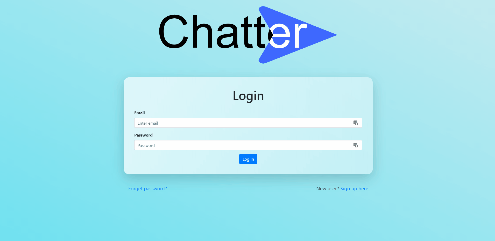
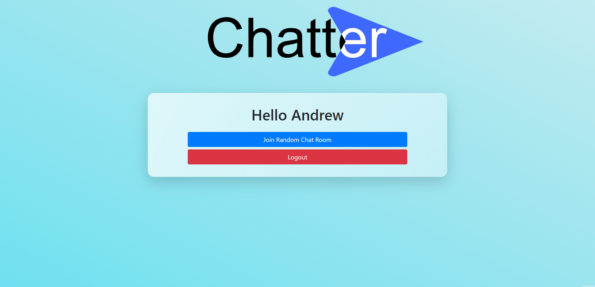
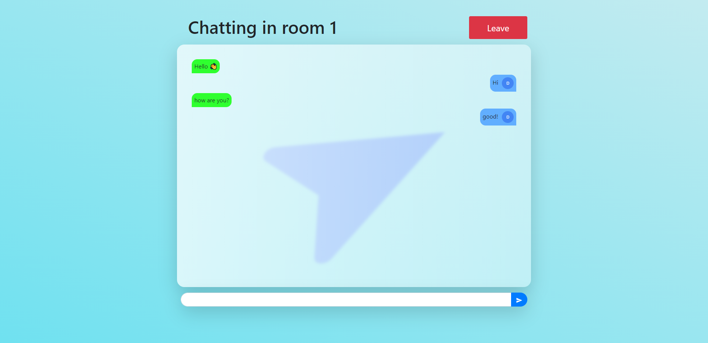

# Chatter


A realtime chatting app built on React-Firebase/Firestore that allows you to chat via text with other users.

See the live demo [here:](https://chatter-zeyu-li.vercel.app/) [chatter-zeyu-li.vercel.app](https://chatter-zeyu-li.vercel.app/)


## Demo






Login screen ^^



Chat Screen ^^

## Packages

* [react](https://reactjs.org/)
* [react-router-dom](https://reactrouter.com/web/guides/quick-start)
* [react-bootstrap](https://react-bootstrap.github.io/)
* [bootstrap](https://getbootstrap.com/)
* [react-icons](https://www.npmjs.com/package/react-icons)
* [react-google-recaptcha-v3](https://www.npmjs.com/package/react-google-recaptcha-v3)
* firebase


## Firebase

Firestore security rules live in [`firestore.rules`](firestore.rules) and deploy with `firebase deploy --only firestore:rules`. They only let signed-in users read the chat, post messages as themselves, and claim a username that is still free.

The `functions/` Cloud Function (`detectEvilUsers`) masks profanity in new messages. It runs on Node.js 22.

## Development

Requires Node.js 24 and Yarn 1.

```sh
yarn install
yarn start   # dev server
yarn build   # production build in build/
yarn test
```
